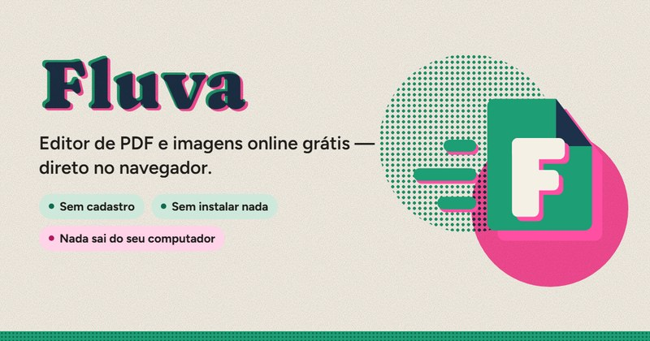
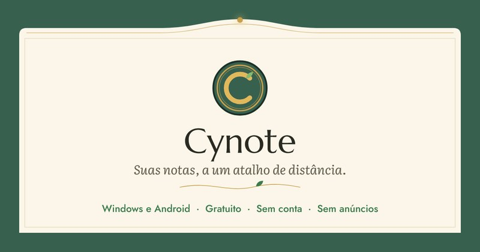
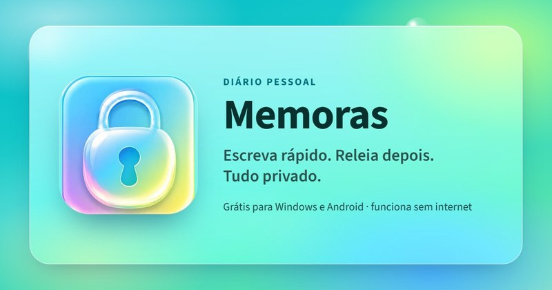
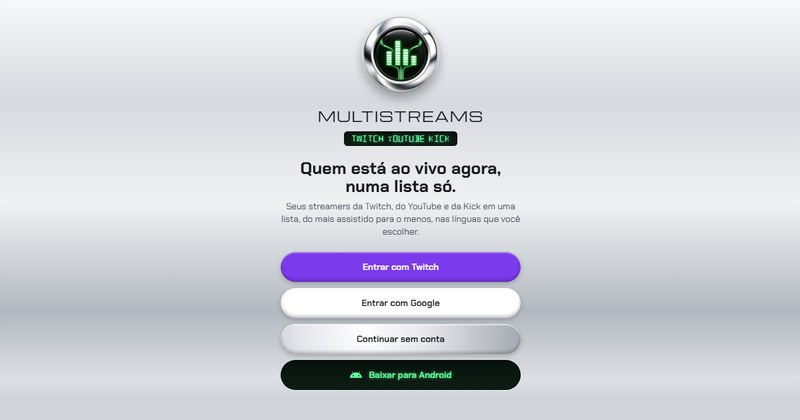
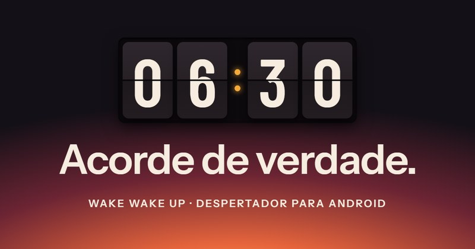
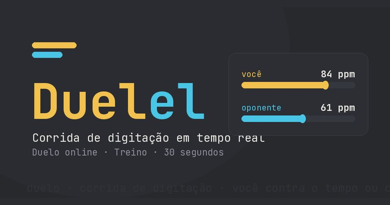
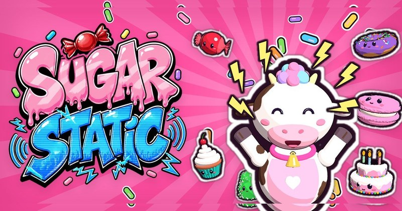
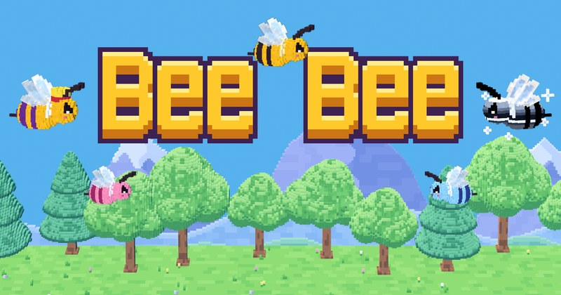
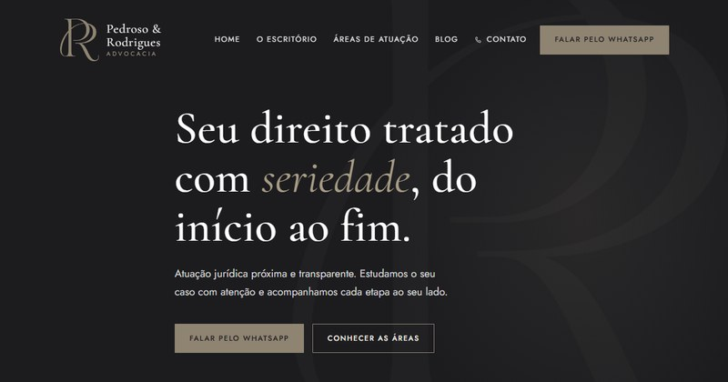
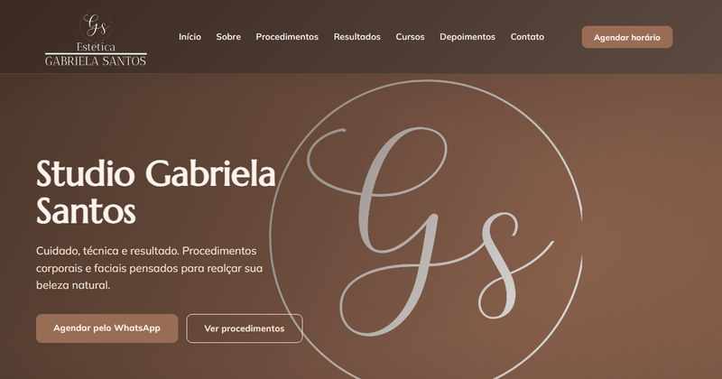

<h1 align="center">vinicius@github:~$</h1>

<p align="center">
  
</p>

<p align="center">
  
  
  
  
</p>

---

### `~/sobre`

```json
{
  "nome": "Vinícius Costa Magalhães",
  "funcoes": ["Desenvolvedor", "Analista de NOC", "Game Designer"],
  "marca": "Cyberhat",
  "dev_desde": 2021,
  "noc_desde": 2024,
  "game_dev_desde": 2017,
  "formacao": {
    "jogos_digitais": "concluído",
    "analise_e_desenvolvimento_de_sistemas": "2.5 anos cursados",
    "engenharia_de_software": "em andamento"
  }
}
```

Desenvolvo sites, apps, sistemas e jogos, além de atuar como Analista de NOC. Publico meus projetos pela **[Cyberhat](https://cyberhat.com.br)**: quase todos estão no ar e são de graça. Hoje um dos meus desafios é retomar projetos antigos, polir cada detalhe e lançar.

---

### `~/projetos`

<table>
  <tr>
    <td width="50%" valign="top">
      <a href="https://fluva.cyberhat.com.br"></a>
      <h3><a href="https://fluva.cyberhat.com.br">Fluva</a></h3>
      Editor de PDF e imagens grátis que roda inteiro no navegador: edita texto, junta, divide, comprime, converte e assina com certificado ICP-Brasil. Os arquivos nunca saem do seu aparelho.
      <br><br>
      <code>React</code> <code>TypeScript</code> <code>Tauri</code> <code>pdf.js</code> <code>PWA</code>
      <br><br>
      <a href="https://fluva.cyberhat.com.br"><b>Abrir</b></a> · <a href="https://github.com/costanoy/Fluva">Código</a>
    </td>
    <td width="50%" valign="top">
      <a href="https://cynote.cyberhat.com.br"></a>
      <h3><a href="https://cynote.cyberhat.com.br">Cynote</a></h3>
      Bloco de notas para Windows e Android que aparece com <kbd>Ctrl</kbd>+<kbd>Shift</kbd>+<kbd>Space</kbd>. Computador e celular sincronizam pelo Wi-Fi com um protocolo P2P próprio, sem conta e sem servidor.
      <br><br>
      <code>Tauri</code> <code>Rust</code> <code>React</code> <code>Flutter</code> <code>mDNS</code>
      <br><br>
      <a href="https://cynote.cyberhat.com.br"><b>Abrir</b></a> · <a href="https://github.com/costanoy/Cynote/releases/latest">Baixar</a> · <a href="https://github.com/costanoy/Cynote">Código</a>
    </td>
  </tr>
  <tr>
    <td width="50%" valign="top">
      <a href="https://memoras.cyberhat.com.br"></a>
      <h3><a href="https://memoras.cyberhat.com.br">Memoras</a></h3>
      Diário pessoal privado para Windows, Android e web, com uma base de código só. Funciona sem internet, tem tranca por PIN e sincroniza com criptografia de ponta a ponta: o servidor só guarda texto cifrado.
      <br><br>
      <code>React</code> <code>Electron</code> <code>Capacitor</code> <code>Supabase</code> <code>Web Crypto</code>
      <br><br>
      <a href="https://memoras.cyberhat.com.br"><b>Abrir</b></a> · <a href="https://github.com/costanoy/Memoras/releases/latest">Baixar</a> · <a href="https://github.com/costanoy/Memoras">Código</a>
    </td>
    <td width="50%" valign="top">
      <a href="https://multistreams.cyberhat.com.br"></a>
      <h3><a href="https://multistreams.cyberhat.com.br">Multistreams</a></h3>
      Junta Twitch, YouTube e Kick numa lista só de quem está ao vivo agora, do mais ao menos assistido, com filtros por idioma e categoria. Na web e no Android, com visual Y2K cromado.
      <br><br>
      <code>React Native</code> <code>Expo</code> <code>Node.js</code> <code>Supabase</code>
      <br><br>
      <a href="https://multistreams.cyberhat.com.br"><b>Abrir</b></a>
    </td>
  </tr>
  <tr>
    <td width="50%" valign="top">
      <a href="https://wakewakeup.cyberhat.com.br"></a>
      <h3><a href="https://wakewakeup.cyberhat.com.br">Wake Wake Up</a></h3>
      Despertador para Android feito para quem dorme pesado: o alarme só desliga depois que você cumpre uma missão, e o app mede quanto tempo você levou para levantar de verdade.
      <br><br>
      <code>Kotlin</code> <code>Jetpack Compose</code> <code>Room</code> <code>MVVM</code>
      <br><br>
      <a href="https://wakewakeup.cyberhat.com.br"><b>Abrir</b></a> · <a href="https://github.com/costanoy/Wake-Wake-Up">Código</a>
    </td>
    <td width="50%" valign="top">
      <a href="https://duelel.cyberhat.com.br"></a>
      <h3><a href="https://duelel.cyberhat.com.br">Duelel</a></h3>
      Corrida de digitação 1 contra 1 em tempo real, por partida rápida ou sala privada, com treino solo e ranking de PPM. Recriado do zero a partir do meu primeiro jogo web, de 2021.
      <br><br>
      <code>Node.js</code> <code>WebSocket</code> <code>PostgreSQL</code> <code>PWA</code>
      <br><br>
      <a href="https://duelel.cyberhat.com.br"><b>Jogar</b></a> · <a href="https://github.com/costanoy/duelel">Código</a>
    </td>
  </tr>
</table>

Também estou construindo o **Veralo**, um ERP para comércios físicos e food deliveries ([protótipo](https://github.com/costanoy/Veralo)).

---

### `~/jogos`

<table>
  <tr>
    <td width="50%" valign="top">
      <a href="https://sugarstatic.cyberhat.com.br"></a>
      <h3><a href="https://sugarstatic.cyberhat.com.br">Sugar Static</a></h3>
      Jogo mobile casual de juntar doces: arremesse no prato, una iguais para criar doces maiores e não deixe nada cair. A vaquinha Glace reage a cada jogada, e todos os modelos 3D foram gerados por código.
      <br><br>
      <code>Godot 4</code> <code>GDScript</code> <code>Jolt Physics</code> <code>Shaders</code>
      <br><br>
      <a href="https://sugarstatic.cyberhat.com.br"><b>Conhecer</b></a>
    </td>
    <td width="50%" valign="top">
      
      <h3>Bee Bee <sub>em breve</sub></h3>
      Jogo de subir sem parar em voxel 3D, para Android e navegador. Com um toque à esquerda ou à direita, a abelha passa pelas roseiras e precisa pegar todas as flores. O céu vai do dia à noite enquanto você sobe.
      <br><br>
      <code>Godot 4</code> <code>GDScript</code> <code>Blender</code> <code>Python</code>
    </td>
  </tr>
</table>

**Em desenvolvimento**

- **Shuriken Break**: ricochete ninja para celular, no estilo do BBTAN, eliminando inimigos com shurikens. `Godot 4`
- **Claude Z: Night Savior**: plataforma infinita em 2.5D com um super-herói que se balança com correntes por uma cidade procedural. `three.js` `Rapier`
- **Guppy**: arcade de crescimento em que você é um peixe que cresce comendo os menores e foge dos maiores. `three.js` `Capacitor`
- **Sperboy**: jogo de ritmo com fases e chefes, refeito a partir do meu primeiro jogo, criado numa Game Jam da faculdade em 2017. `three.js` `Capacitor`

---

### `~/clientes`

<table>
  <tr>
    <td width="50%" valign="top">
      <a href="https://pedrosoerodriguesadvocacia.com.br"></a>
      <h3><a href="https://pedrosoerodriguesadvocacia.com.br">Pedroso & Rodrigues Advocacia</a></h3>
      Site institucional de um escritório de advocacia, com blog e painel próprio onde as advogadas publicam artigos sem depender de um programador. Otimizado para SEO e buscas locais.
      <br><br>
      <code>HTML</code> <code>CSS</code> <code>JavaScript</code> <code>PHP</code> <code>SEO</code>
    </td>
    <td width="50%" valign="top">
      <a href="https://studiogabrielasantos.com.br"></a>
      <h3><a href="https://studiogabrielasantos.com.br">Studio Gabriela Santos</a></h3>
      Site de um estúdio de estética em Goianésia-GO, com procedimentos, galeria de antes e depois com comparador interativo, cursos, depoimentos e agendamento direto pelo WhatsApp.
      <br><br>
      <code>HTML</code> <code>CSS</code> <code>JavaScript</code> <code>SEO</code>
    </td>
  </tr>
</table>

---

### `~/stack`

<p align="left">
  
  
  
  
  
  
  
  
  
</p>

<p align="left">
  
  
  
  
  
  
  
  
</p>

<p align="left">
  
  
  
  
  
  
  
  
  
</p>

---

### `~/stats`

<p align="center">
  
  
</p>

---

### `~/contato`

<table align="center">
  <tr>
    <td align="center" width="140">
      <a href="https://portfolio.cyberhat.com.br">
        <br>
        <sub><b>Portfólio</b></sub>
      </a>
    </td>
    <td align="center" width="140">
      <a href="https://www.linkedin.com/in/vinicius-costa-magalhaes">
        <br>
        <sub><b>LinkedIn</b></sub>
      </a>
    </td>
    <td align="center" width="140">
      <a href="mailto:vinicostamaga@outlook.com">
        <br>
        <sub><b>E-mail</b></sub>
      </a>
    </td>
    <td align="center" width="140">
      <a href="https://wa.me/5561981374048">
        <br>
        <sub><b>WhatsApp</b></sub>
      </a>
    </td>
  </tr>
</table>

<p align="center">
  <sub>✦ aberto a oportunidades remotas ✦</sub>
</p>

<br>

<p align="center">© Vinícius Costa Magalhães</p>
